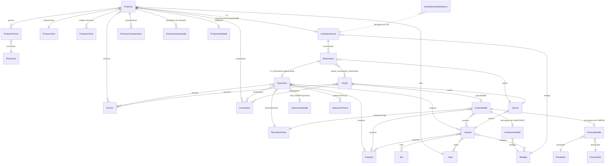

# Modelo de datos del API (`api/src/entity`)

Base de datos: MariaDB. ORM: TypeORM 0.2 con `synchronize: true` (el esquema se genera
desde las entidades; **no hay migraciones**). Todas las entidades viven en `api/src/entity/`.
Las entidades en `api/src/entity-old/` pertenecen al sistema anterior y no se cargan en
la conexión (`ormconfig.js` solo incluye `src/entity/**/*.ts`).

## Convenciones

- Casi todas las entidades declaran `sesionId: number` **sin** `@Column`. No se persiste; lo
  usa el suscriptor `GeneralSubscriber` (`src/subscriber/suscriberLog.ts`) para registrar en
  `LogFuncionamiento` quién hizo cada insert/update/remove.
- `NombreEstatus` (`entity/common/NombreEstatus.ts`) es la clase base con `id`, `nombre`
  (único) y `estatus` (`activo | inactivo | finalizado | eliminado`). La heredan los catálogos:
  `Area`, `Bodega`, `Proyecto`, `Proveedor`, `Rol`, `MovimientoTipo`, `FacturaTipo`,
  `PrecioTipo`, `ProductoTipo`, `Grupo`, `ProductoValidado`, `ProductoInventariado`.
- Las columnas `numeric(15,4)` y `numeric(15,2)` las devuelve el driver **como string**.
  Varios controladores hacen `+=` o `=== 0` sobre ellas (ver `docs/hallazgos-codigo.md`).
- Casi todas las relaciones `ManyToOne` son `eager: true`, lo que provoca cargas en cascada
  muy grandes en cada `find`.

## Diagrama de entidades (núcleo operativo)

## Entidades y su significado

| Entidad | Tabla | Qué representa |
|---|---|---|
| `Producto` | `producto` | Artículo del catálogo (título, descripción, área, tipo, códigos, precios, archivos). |
| `InventarioActual` | `inventario_actual` | **Existencia** de un producto en una bodega. `cantidadAlmacen` = cantidad dada de alta; `cantidad` = disponible ahora; `disponible` ∈ `disponible, no-disponible, baja, cuarentena`. Relación 1:1 con `Producto`, así que hoy un producto solo puede existir en una bodega. |
| `InventarioActualHistorico` | `inventario_actual_historico` | Instantánea de `InventarioActual` **antes** de cada operación que lo modifica. Se usa como pila para deshacer (`MovimientoController.quitar`). Se relaciona por `idOriginal`, sin FK ni referencia al movimiento que la generó. |
| `Movimiento` | `movimiento` | Línea de un listado (`Grupo`): una `cantidad` de un `InventarioActual`. Puede o no tener `Operacion`. `estatus` `activo` marca el **último movimiento con operación** de cada inventario (cadena implícita, ver abajo). No tiene fecha propia. |
| `Operacion` | `operacion` | La acción de negocio aplicada a un movimiento: tipo (`MovimientoTipo`), proyecto, usuarios responsables, fecha, comentarios, archivos. 1:1 con `Movimiento`. |
| `OperacionDetalle` | `operacion_detalle` | Precio unitario/total y moneda. Solo para operaciones de COMPRA (tipo 15). |
| `OperacionPrecio` | `operacion_precio` | Precios por tipo asociados a una operación (renta, préstamo). Declarado pero prácticamente sin uso en controladores. |
| `MovimientoTipo` | `movimiento_tipo` | Catálogo de los 17 tipos (ver `tipos-de-movimiento.md`). Los ids están **hardcodeados** en el código. |
| `Grupo` | `grupo` | Listado de movimientos (una compra/factura, un préstamo a un proyecto, un inventario, una lista libre). Nombre único. |
| `GrupoDetalle` | `grupo_detalle` | Cabecera del grupo: tipo de movimiento, proyecto, usuarios; opcionalmente `FacturaDetalle` (compra) o `InventarioDetalle` (inventario físico). |
| `FacturaDetalle` | `factura_detalle` | Datos de la factura de una compra: número, fecha, total, impuestos, monto ingresado, proveedor, tipo de factura. |
| `InventarioDetalle` | `inventario_detalle` | Fechas inicio/fin y bodega de un inventario físico. |
| `ProductoInventariado` | `producto_inventariado` | Resultado de revisar un producto en un inventario (`inventarioPositivo`, `inventarioNegativo`, `no-revisado`). También lo escribe `Movimiento.Controller` en cada operación. |
| `ProductoValidado` | `producto_validado` | Validación de calidad del producto (`valido`, `invalido`, `no-revisado`). |
| `ProductoClave` | `producto_clave` | Código de barras (`barras`, único) y su tipo. Es la llave con la que el front identifica artículos (`obtenerInventarioActualDeCodigo`). |
| `ProductoPrecio` / `PrecioTipo` | `producto_precio`, `precio_tipo` | Precios por tipo (compra, renta, etc.) y moneda. |
| `ProductoCaracteristica` | `producto_caracteristica` | Pares llave/valor libres. |
| `Bodega` | `bodega` | Almacén físico. `cobacha: boolean` marca bodegas secundarias. |
| `Area` | `area` | Departamento/área dueña de productos. Limita lo que ve cada usuario. |
| `Proyecto` | `proyecto` | Producción/proyecto al que se prestan artículos. `esExterno` para rentas externas. |
| `Proveedor` / `FacturaTipo` | | Catálogos de compras. |
| `Usuario`, `Rol`, `Sesion` | | Usuario con roles (códigos `ADMINISTRADOR`, `GRUPOS-NUEVO`, …), áreas, bodegas y proyectos permitidos. Cada login crea una `Sesion`; el JWT lleva `{ui, u, si}` = usuario id, nombre, sesión id. |
| `Archivo` | `archivo` | Binario en `mediumblob` + metadatos. Se asocia N:M a producto, operación, grupo, usuario. |
| `Comentario` | `comentario` | Texto + sesión. N:M con casi todo. |
| `LogFuncionamiento` | | Auditoría automática de insert/update/remove (suscriptor). |
| `LogGeneral` | | Errores capturados por `errorMiddlewere`. |
| `LogPeticiones` | | Métricas por petición HTTP (`request-stats`). |
| `Parametros` | | Pares llave/valor de configuración. |

## Cómo se encadenan hoy los movimientos (el problema a resolver)

No existe ninguna columna que diga "esta DEVOLUCIÓN corresponde a aquel PRÉSTAMO".
La relación se reconstruye de tres formas indirectas:

1. **`Movimiento.estatus`** como puntero al último movimiento con operación de un
   `InventarioActual`: `agregarOperacionAMovimiento` pone en `inactivo` el movimiento
   `activo` anterior; `quitar` reactiva el último `inactivo`. Si hay más de un `activo`
   (por errores o concurrencia) el puntero se corrompe.
2. **Suma por tipo y proyecto** (`aceptarDevolucionBaja` en `Movimiento.Controller.ts`):
   suma `-cantidad` para tipos 3, 11, 12, 15 y `+cantidad` para 4, 7, 13, 16 filtrando por
   proyecto; si el resultado es 0 se rechaza la devolución/baja. No distingue préstamos
   múltiples ni devoluciones parciales.
3. **Pila `InventarioActualHistorico`** por `idOriginal`: al deshacer un movimiento se
   restaura la **última** instantánea aunque no corresponda a ese movimiento.

El plan `docs/planes/02-api-relacion-movimientos.md` propone la relación explícita
`Movimiento.movimientoOrigen` y el campo `fecha`, además de ligar cada histórico a su
movimiento.
