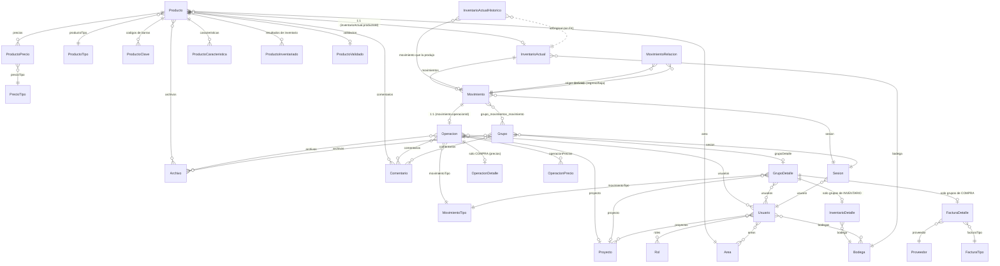

# Modelo de datos del API (`api/src/entity`)

Base de datos: MariaDB. ORM: TypeORM 1.1 (`api/src/data-source.ts`). Desde la fase 3 del plan 02 el esquema lo cambian las
**migraciones** de `api/src/migration/` (`DB_SYNCRO=false`; procedimiento en
[`procedimiento-migracion-produccion.md`](procedimiento-migracion-produccion.md)). Todas las entidades viven en `api/src/entity/`.
Las entidades en `api/src/entity-old/` pertenecen al sistema anterior y no se cargan en
la conexión (`AppDataSource` usa la lista `ENTIDADES` de `src/entity/index.ts`).

## Convenciones

- Casi todas las entidades declaran `sesionId: number` **sin** `@Column`. No se persiste; lo
  usa el suscriptor `GeneralSubscriber` (`src/subscriber/suscriberLog.ts`) para registrar en
  `LogFuncionamiento` quién hizo cada insert/update/remove.
- `NombreEstatus` (`entity/common/NombreEstatus.ts`) es la clase base con `id`, `nombre`
  (único) y `estatus` (`activo | inactivo | finalizado | eliminado`). La heredan los catálogos:
  `Area`, `Bodega`, `Proyecto`, `Proveedor`, `Rol`, `MovimientoTipo`, `FacturaTipo`,
  `PrecioTipo`, `ProductoTipo`, `Grupo`, `ProductoValidado`, `ProductoInventariado`.
- Las columnas `numeric(15,4)` y `numeric(15,2)` las devuelve el driver **como string**.
  Varios controladores hacen `+=` o `=== 0` sobre ellas (ver `docs/hallazgos-codigo.md`).
- Casi todas las relaciones `ManyToOne` son `eager: true`, lo que provoca cargas en cascada
  muy grandes en cada `find`.

## Diagrama de entidades (núcleo operativo)

## Entidades y su significado

| Entidad | Tabla | Qué representa |
|---|---|---|
| `Producto` | `producto` | Artículo del catálogo (título, descripción, área, tipo, códigos, precios, archivos). |
| `InventarioActual` | `inventario_actual` | **Existencia** de un producto en una bodega. `cantidadAlmacen` = cantidad dada de alta; `cantidad` = disponible ahora; `disponible` ∈ `disponible, no-disponible, baja, cuarentena`. Relación 1:1 con `Producto`, así que hoy un producto solo puede existir en una bodega. |
| `InventarioActualHistorico` | `inventario_actual_historico` | Instantánea de `InventarioActual` **antes** de cada operación (todas, incluidas compras y altas). `movimiento` (FK, `SET NULL`) indica qué movimiento la produjo; las anteriores a la fase 3 solo tienen `idOriginal`. `MovimientoService.deshacer` restaura la instantánea ligada a compras y bajas. |
| `Movimiento` | `movimiento` | Línea de un listado (`Grupo`): una `cantidad` de un `InventarioActual`. Puede o no tener `Operacion`. `fecha` propia (creación). `legado = true` para los anteriores a la fase 3 (sin relaciones). `estatus` `activo` marca el **último movimiento con operación** de cada inventario (`@deprecated`, lo lee el front; se recalcula en cada operación). |
| `MovimientoRelacion` | `movimiento_relacion` | Relación N:M **origen → derivado** con `cantidad` y `tipo` (`devolucion`, `baja`, `transferencia`, `cierre-inventario`). Origen = salida (3, 11, 12, 15; o 7 para su 12); derivado = regreso o baja. `UNIQUE(origen, derivado)`; origen `RESTRICT`, derivado `CASCADE`. |
| `v_movimiento_saldo` (vista) | | Una fila por movimiento con saldo (tipos 3, 7, 11, 12, 15): `cantidad`, `aplicado` (Σ relaciones como origen), `saldo`, `proyectoId`, `fecha`, `legado`. La usan las validaciones y el listado de pendientes. |
| `Operacion` | `operacion` | La acción de negocio aplicada a un movimiento: tipo (`MovimientoTipo`), proyecto, usuarios responsables, fecha, comentarios, archivos. 1:1 con `Movimiento`. |
| `OperacionDetalle` | `operacion_detalle` | Precio unitario/total y moneda. Solo para operaciones de COMPRA (tipo 15). |
| `OperacionPrecio` | `operacion_precio` | Precios por tipo asociados a una operación (renta, préstamo). Declarado pero prácticamente sin uso en controladores. |
| `MovimientoTipo` | `movimiento_tipo` | Catálogo de los 17 tipos (ver `tipos-de-movimiento.md`). Los ids están **hardcodeados** en el código. |
| `Grupo` | `grupo` | Listado de movimientos (una compra/factura, un préstamo a un proyecto, una lista libre). Nombre único. Con `GrupoDetalle`, todas sus líneas son del tipo del listado (decisión 11). |
| `GrupoDetalle` | `grupo_detalle` | Cabecera del grupo: tipo de movimiento, proyecto, usuarios; opcionalmente `FacturaDetalle` (compra) o `InventarioDetalle` (inventario físico). |
| `FacturaDetalle` | `factura_detalle` | Datos de la factura de una compra: número, fecha, total, impuestos, monto ingresado, proveedor, tipo de factura. |
| `InventarioDetalle` | `inventario_detalle` | Fechas inicio/fin y bodega de un inventario físico. **Sin uso:** los endpoints que lo creaban se retiraron (decisión 10); se conserva por los grupos antiguos. |
| `ProductoInventariado` | `producto_inventariado` | Resultado de revisar un producto en un inventario (`inventarioPositivo`, `inventarioNegativo`, `no-revisado`). También lo escribe `MovimientoService.registrarOperacion` en cada operación. |
| `ProductoValidado` | `producto_validado` | Validación de calidad del producto (`valido`, `invalido`, `no-revisado`). |
| `ProductoClave` | `producto_clave` | Código de barras (`barras`, único) y su tipo. Es la llave con la que el front identifica artículos (`obtenerInventarioActualDeCodigo`). |
| `ProductoPrecio` / `PrecioTipo` | `producto_precio`, `precio_tipo` | Precios por tipo y moneda. Solo se usa el tipo 2 (COMPRA ORIGEN); los artículos nuevos solo guardan ese (decisión 13). |
| `ProductoCaracteristica` | `producto_caracteristica` | Pares llave/valor libres. |
| `Bodega` | `bodega` | Almacén físico. `cobacha: boolean` marca bodegas secundarias. |
| `Area` | `area` | Departamento/área dueña de productos. Limita lo que ve cada usuario. |
| `Proyecto` | `proyecto` | Producción/proyecto al que se prestan artículos. `esExterno` para rentas externas. |
| `Proveedor` / `FacturaTipo` | | Catálogos de compras. |
| `Usuario`, `Rol`, `Sesion` | | Usuario con roles (códigos `ADMINISTRADOR`, `GRUPOS-NUEVO`, …), áreas, bodegas y proyectos permitidos. Cada login crea una `Sesion`; el JWT lleva `{ui, u, si}` = usuario id, nombre, sesión id. |
| `Archivo` | `archivo` | Binario en `mediumblob` + metadatos. Se asocia N:M a producto, operación, grupo, usuario. |
| `Comentario` | `comentario` | Texto + sesión. N:M con casi todo. |
| `LogFuncionamiento` | | Auditoría automática de insert/update/remove (suscriptor). |
| `LogGeneral` | | Errores capturados por `errorMiddlewere`. |
| `LogPeticiones` | | Métricas por petición HTTP (`request-stats`). |
| `Parametros` | | Pares llave/valor de configuración. |

## Cómo se encadenan los movimientos (fase 3 del plan 02)

Desde la fase 3 la relación es **explícita** en `movimiento_relacion` (decisión 5: N:M, una devolución puede cubrir
varios préstamos). La lógica vive en `api/src/services/`:

| Pieza | Qué hace |
|---|---|
| `reglas/efectosInventario.ts` | Función pura tipo → nuevo `{cantidad, cantidadAlmacen, disponible}` (y su inverso para deshacer). |
| `reglas/planificarRelaciones.ts` | Función pura: a qué salidas abiertas se aplica un regreso y por cuánto (FIFO, explícitas, `strict`, compatibilidad). |
| `MovimientoService.registrarOperacion` | Transacción: `SELECT … FOR UPDATE` del inventario → efecto → relaciones → operación → movimiento → instantánea ligada → inventario → `movimiento_relacion` → `estatus` → `ProductoInventariado` → grupo. |
| `MovimientoService.deshacer` | 409 si es origen; borra sus relaciones (CASCADE); salidas/regresos/altas por efecto inverso; compras/bajas restauran su instantánea si son el último movimiento. |

Reglas (plan 02 §2.1):

1. Un regreso (4, 7, 13, 16, 5) se relaciona con salidas (3, 11, 12, 15) del **mismo inventario y proyecto** con saldo
   pendiente; `Σ relacion.cantidad = derivado.cantidad` y cada `cantidad ≤ saldo`.
2. `saldo(origen) = origen.cantidad − Σ relacion.cantidad` (vista `v_movimiento_saldo`; no se persiste).
3. La **compra (15) es origen**: el artículo comprado nace "en el proyecto" (`cantidad 0`, no disponible) hasta su
   primera devolución al almacén. (Desviación documentada respecto del plan, que solo listaba 3, 11 y 12.)
4. Transferencia: el 7 se relaciona con las salidas del proyecto A; el 12 (proyecto B) con el 7; la devolución en B
   con el 12.
5. Las bajas sin proyecto (8, 17) cierran todas las salidas abiertas del inventario (`cierre-inventario`).
6. Sin `relaciones` en la petición, reparto **FIFO**; con `strict: true` y varias candidatas, 409 con las candidatas.
7. **Compatibilidad** (sin backfill): los movimientos anteriores a la fase 3 tienen `legado = 1` y no cuentan en la
   vista. Lo que las salidas nuevas no cubren se acepta contra el saldo legado del proyecto (heurística anterior:
   salidas legadas − regresos legados − la parte no relacionada de los regresos nuevos) y se registra en
   `LogGeneral` con nivel `advertencia`.
8. Cambiar el proyecto de una operación que ya tiene relaciones responde 409 (`services/guardasRelacion.ts`).

Antes de la fase 3 la relación se reconstruía con tres mecanismos frágiles (el puntero `estatus`, la suma por tipo y
proyecto de `aceptarDevolucionBaja` y la pila de históricos por `idOriginal`); ver `hallazgos-codigo.md` (C7, H17).
