# 1 · El flujo de datos

Esta guía explica **qué guarda el sistema y cómo se mueve la información**. No hace falta saber de computación:
si entiendes una hoja de préstamo en papel, entiendes el sistema.

## 1. El viaje de un artículo

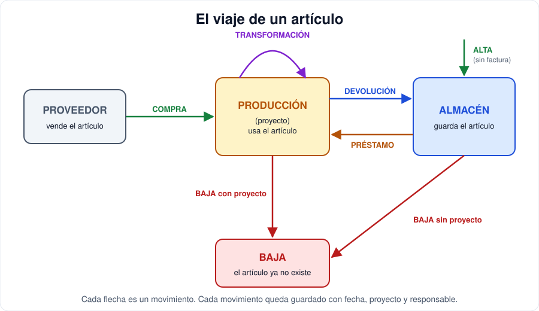

Un artículo siempre está en uno de dos lugares:

- 🟦 **En el almacén**: está guardado y se puede prestar.
- 🟧 **Con una producción** (un proyecto): alguien lo está usando.

Cada flecha del dibujo es un **movimiento**:

| Movimiento | Qué significa | De dónde → a dónde |
|---|---|---|
| **Compra** | Una producción compró algo con factura. | Proveedor → Producción |
| **Alta** | Entra algo al almacén sin factura. | → Almacén |
| **Préstamo** | El almacén entrega algo a una producción. | Almacén → Producción |
| **Devolución** | La producción regresa algo al almacén. | Producción → Almacén |
| **Baja** | El artículo se gastó, se rompió o se perdió. | → Deja de existir |
| **Transformación** | La producción convirtió un artículo en otro. | Producción → Producción |
| **Renta externa** | Se presta a un proyecto externo. | Almacén → Proyecto externo |

## 2. Las palabras del sistema

| Palabra | En palabras simples | Ejemplo |
|---|---|---|
| **Artículo / Producto** | Una cosa del almacén. Puede tener varias unidades. | CHALECO AMARILLO (25 piezas) |
| **Clave** | El código de barras del artículo. Es único. | `0000005286` |
| **Área** | A qué departamento pertenece. | Utilería, Decoración, Producción, Maquillaje y Peinado |
| **Proyecto** | La producción que usa los artículos. | EL NEGRO, LA VENTA |
| **Responsables** | Las personas que reciben o entregan los artículos. | Quien firma la hoja |
| **Movimiento** | Un renglón: «este artículo, esta cantidad». | Préstamo de 5 chalecos |
| **Listado** | La hoja donde se anotan los movimientos. | EN-UTILERÍA-P1 |
| **Proveedor** | A quién se le compró. | AMAZON |
| **Almacén** | El lugar físico donde se guarda. | BODEGA CEDRO |

## 3. Un listado es una hoja

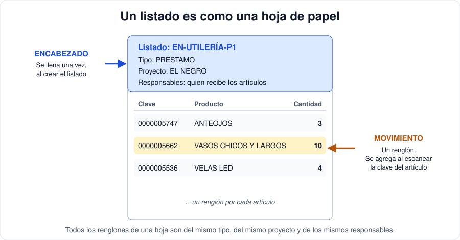

- El **encabezado** se llena una sola vez: tipo de operación, proyecto, responsables y nombre.
- Después se agrega **un renglón por artículo**: se escanea la clave y se pone la cantidad.
- Todos los renglones de una hoja comparten el tipo, el proyecto y los responsables.

Así se ve un listado de préstamo en el sistema: arriba el encabezado, en medio el campo para escanear y abajo los
renglones.

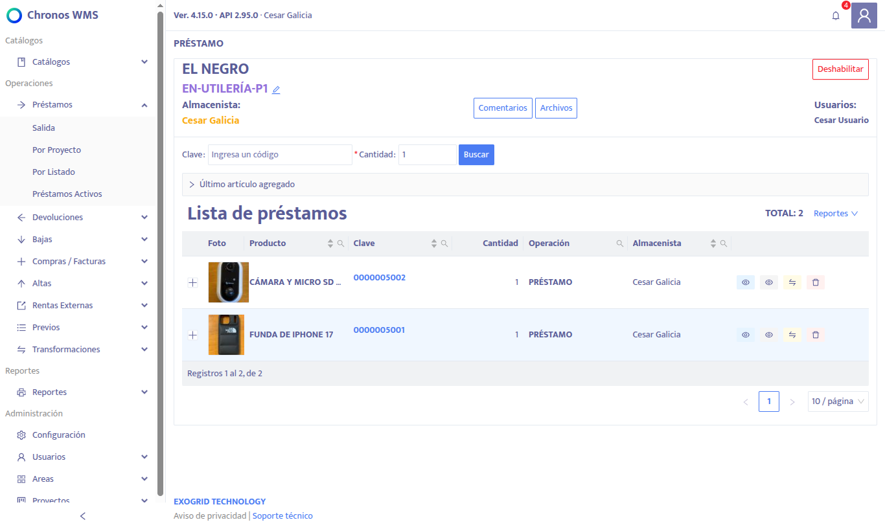

> 💡 Si en papel harías «una hoja de salida para Utilería de EL NEGRO», en el sistema es un listado de préstamo.

## 4. Siempre son 3 pasos

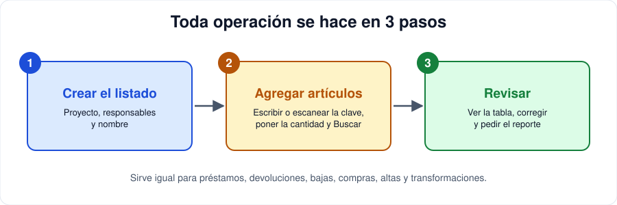

Préstamos, devoluciones, bajas, compras, altas y transformaciones se hacen igual. Cambia el menú, no la forma de
trabajar.

## 5. Las cantidades: ¿dónde están mis cosas?

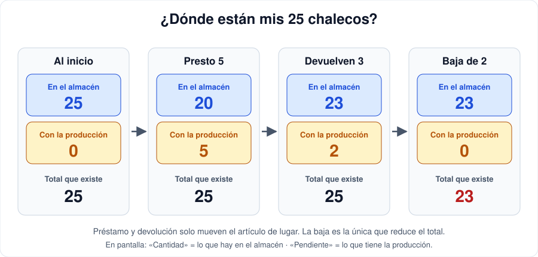

El sistema lleva tres números por artículo:

| Número | Qué es |
|---|---|
| **En el almacén** | Lo que se puede prestar hoy. |
| **Con la producción** (pendiente) | Lo que está prestado y falta por regresar. |
| **Total** | La suma de los dos. Solo baja cuando hay una **baja**. |

Reglas que el sistema cuida por ti:

- ❌ No deja prestar más de lo que hay en el almacén.
- ❌ No deja devolver algo que no está prestado.
- ❌ No deja devolver a un proyecto lo que se prestó a otro.

## 6. Las compras

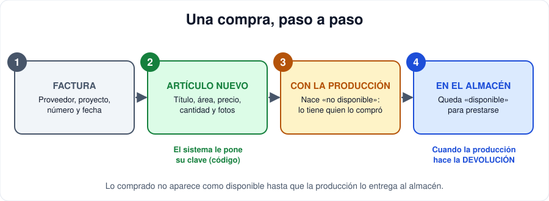

Lo que una producción compra **nace con la producción**, no en el almacén. Aparece como «no disponible» hasta que la
producción lo entrega con una **devolución**. Así se sabe siempre quién tiene lo que se compró.

## 7. Las bajas

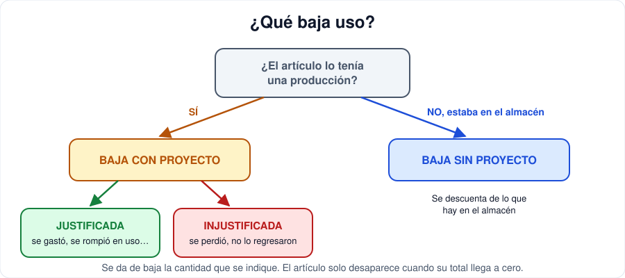

- **Justificada**: se gastó o se rompió por el uso normal.
- **Injustificada**: se perdió o no lo regresaron.
- Se da de baja **la cantidad que indiques**. Si tienes 25 y das de baja 2, quedan 23.

## 8. Regular y expendable

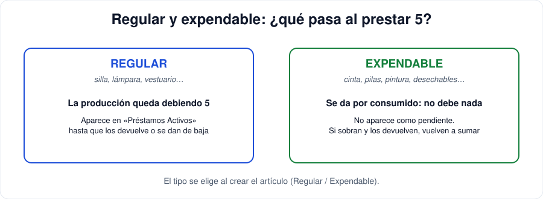

Un **expendable** es algo que se gasta al usarse (cinta, pilas, pintura). Al prestarlo, el sistema lo da por
consumido: la producción **no queda debiendo** nada.

## 9. Transformación

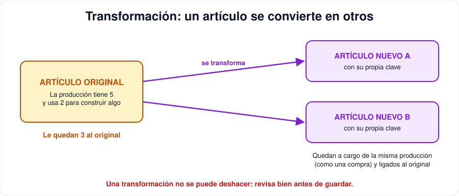

Se usa cuando la producción toma un artículo y construye otra cosa con él. Lo usado se descuenta y nacen artículos
nuevos, con su propia clave, a cargo de la misma producción.

## 10. Quién puede hacer qué

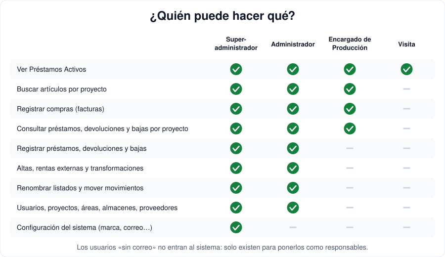

Cada persona entra con su usuario y ve **solo los menús de su perfil**. Si no ves un menú, tu perfil no lo incluye.

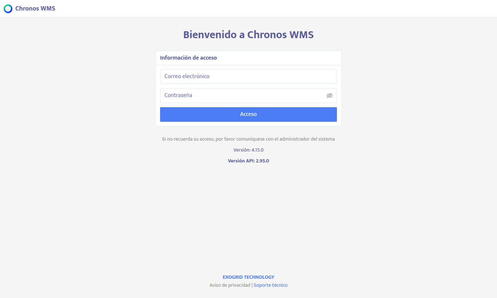

## 11. Los reportes

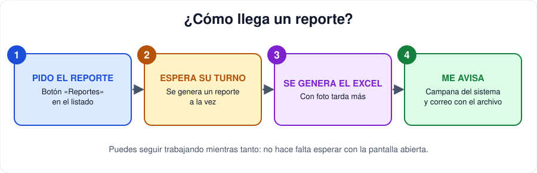

Los reportes son archivos de Excel. Se generan **uno a la vez**: si alguien pidió uno antes, el tuyo espera su turno
y el sistema te lo dice. Cuando está listo, te avisa la campana 🔔 y te llega por correo.

---

Siguiente: la guía de tu perfil → [Operador](02-operador-almacen.md) ·
[Encargado de producción](03-encargado-produccion.md) · [Administrador](04-administrador.md)
