# 2 · Guía del operador de almacén

Para quien entrega, recibe y registra artículos. Antes lee [El flujo de datos](01-flujo-de-datos.md).

> Los operadores entran con un usuario de perfil **Administrador** (o con permisos personalizados que le asigne el
> administrador). Si no ves alguno de estos menús, pídeselo a tu administrador.

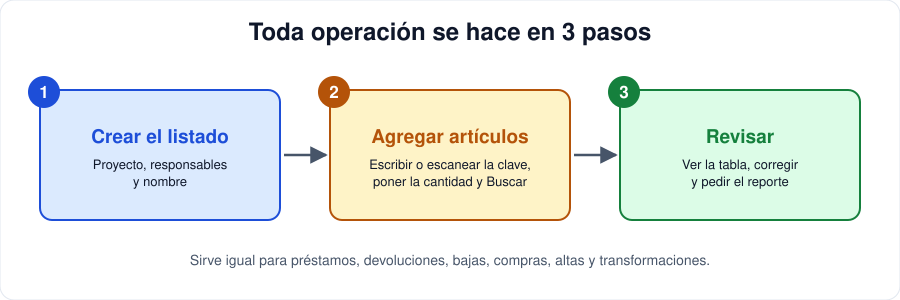

## Lo que se repite en todas las operaciones

**Paso 1 · Crear el listado** (el encabezado de la hoja)

| Campo | Qué poner |
|---|---|
| **Area** | El departamento. Solo sirve para armar el nombre. |
| **Proyecto Interno** | La producción. |
| **Nombre listado** | Pulsa **Crear Nombre** y el sistema propone uno, por ejemplo `EN-UTILERÍA-P1` (proyecto-área-tipo-número). |
| **Usuarios Responsables** | Escribe el nombre de la persona y elígela. Pueden ser varias. |

**Paso 2 · Agregar artículos**

1. Pon el cursor en **Clave** y escanea el código (o escríbelo).
2. Revisa la **Cantidad** (siempre empieza en 1).
3. Pulsa **Buscar** (o Enter). El artículo aparece en la tabla y en «Último artículo agregado».

**Paso 3 · Revisar**

- La tabla de abajo es tu hoja. Cuenta los renglones contra lo que tienes físicamente.
- Si te equivocaste, pulsa el **bote de basura** 🗑 del renglón (Quitar producto): el sistema deshace el movimiento.

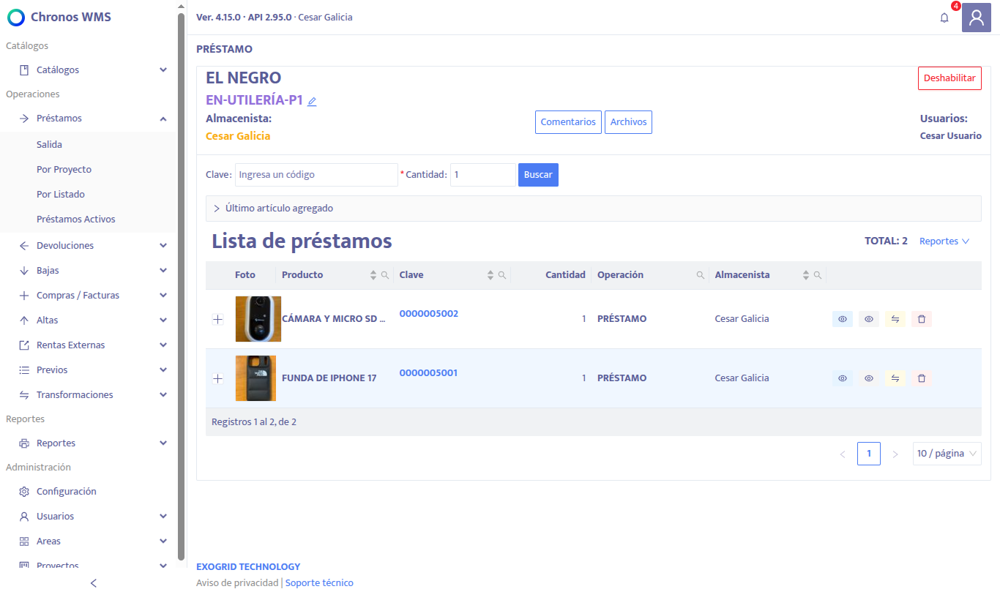

Los iconos de cada renglón: 👁 ver el artículo o el movimiento · ⇆ mover a otro listado (solo administradores) ·
🗑 quitar.

> 💡 Puedes cerrar la pantalla y volver después: el listado se queda guardado. Lo encuentras en **Por Listado**.

---

## A. Préstamo (salida del almacén)

**Menú:** Operaciones → Préstamos → **Salida**

1. Llena el encabezado y pulsa **Crear préstamo**.

   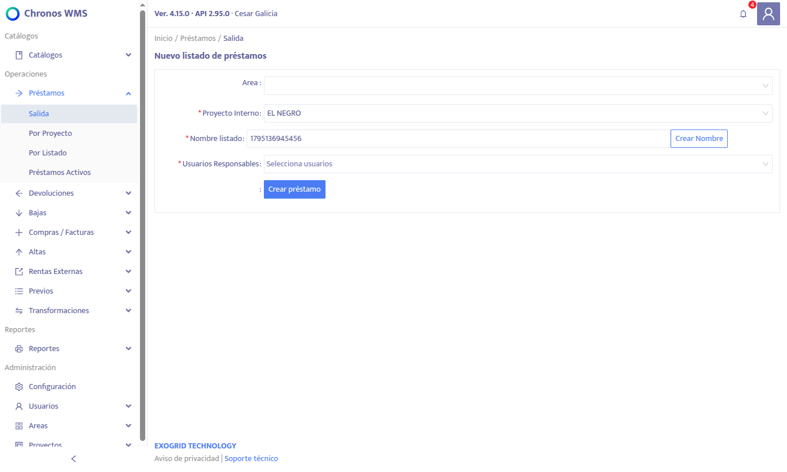

2. Escanea cada artículo con su cantidad.
3. Revisa la tabla.

Qué pasa con los datos: el artículo pasa de 🟦 almacén a 🟧 producción. Queda **pendiente** de regresar.

| Si el sistema dice… | Significa… |
|---|---|
| NO HAY EXISTENCIA DISPONIBLE DEL ARTÍCULO | Todas las unidades están prestadas o recién compradas y sin entregar. |
| NO HAY EXISTENCIA SUFICIENTE… EXISTENCIA: 3 SOLICITADO: 5 | Pediste más de lo que hay. Baja la cantidad. |

**Para consultar:** Préstamos → **Préstamos Activos**. Elige el proyecto y pulsa **Buscar**: muestra todo lo que está
fuera y lo que falta por regresar (columna **Pendiente**, por ejemplo «1 de 1»).

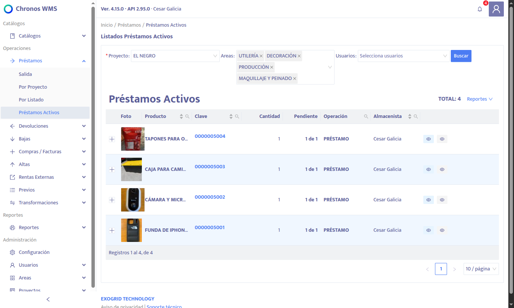

## B. Devolución (regreso al almacén)

**Menú:** Operaciones → Devoluciones → **Devolución**

1. Llena el encabezado con **el mismo proyecto** que tiene los artículos y pulsa **Crear devolución**.
2. Escanea cada artículo y pon cuántas unidades regresan (puede ser una parte).
3. Revisa la tabla.

Qué pasa con los datos: el artículo vuelve de 🟧 producción a 🟦 almacén y el pendiente baja.

> ⚠️ Lo que una producción **compró** también se recibe con una devolución: así entra por primera vez al almacén.

## C. Baja

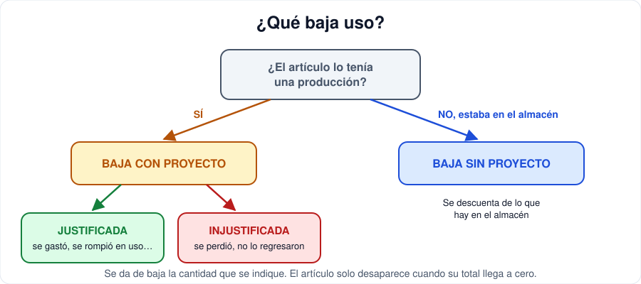

**Con proyecto** (lo tenía una producción): Operaciones → Bajas → con Proyecto → **Baja**

1. Llena el encabezado, elige **Tipo de baja** (Justificada o Injustificada) y pulsa **Crear baja**.

   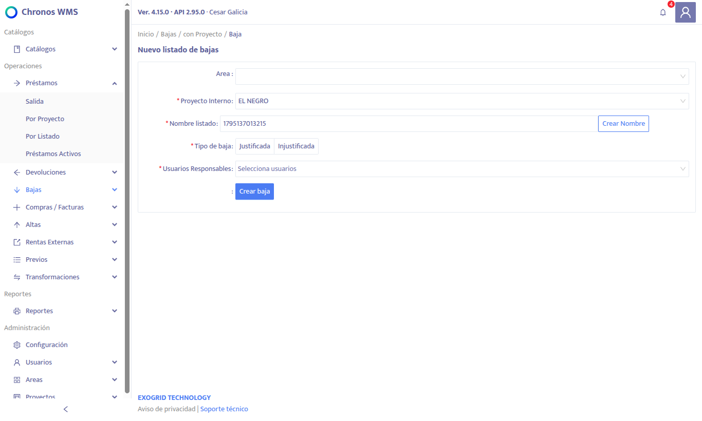

2. Escanea el artículo y pon **cuántas unidades** se dan de baja.

**Sin proyecto** (estaba en el almacén): Operaciones → Bajas → Sin Proyecto → **Baja Sin Proyecto**

> ⚠️ Revisa la cantidad. Una baja de 1 sobre un artículo de 25 deja 24. El artículo solo desaparece cuando llega a cero.

## D. Compra (factura)

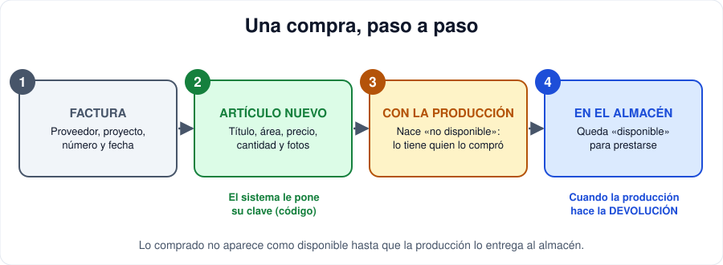

**Menú:** Operaciones → Compras / Facturas → **Nueva Factura**

1. Encabezado: **Proyecto Interno**, **Proveedor** (escribe para buscarlo), **Tipo Factura**, **Fecha factura**,
   **Número Factura** y **Usuarios Responsables**. Pulsa **Crear factura**.

   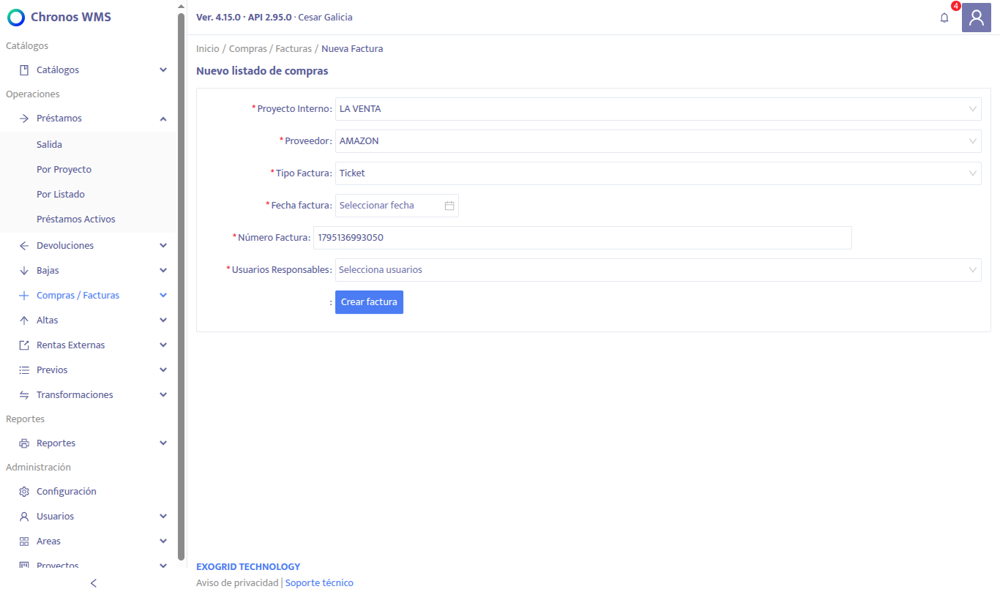

2. Por cada artículo de la factura hay 4 pantallitas:
   1. **Datos generales**: título, descripción, **Tipo** (Regular o Expendable), cantidad, precio unitario, moneda,
      área y almacén → **Guardar y siguiente**.
   2. **Fotos**: sube la foto del artículo.
   3. **Características** y 4. **Comentarios**: opcionales.
3. El sistema crea el artículo y le pone su **clave**. Imprime o anota la etiqueta.

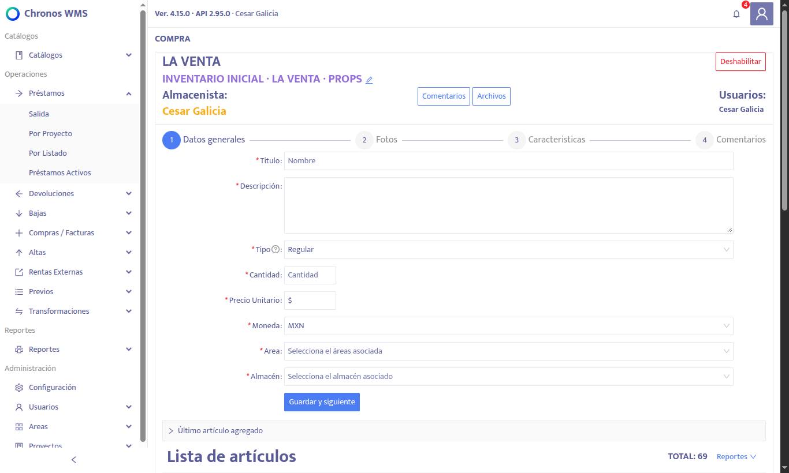

Qué pasa con los datos: el artículo nace 🟧 con la producción que lo compró. Cuando lo entregue, se recibe con una
**devolución** (sección B).

## E. Alta (sin factura)

**Menú:** Operaciones → Altas → **Alta**. Igual que una compra, pero sin proveedor ni factura. El artículo entra
directo al 🟦 almacén, disponible.

## F. Transformación

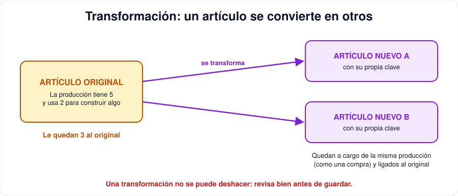

**Menú:** Operaciones → Transformaciones → **Nueva Transformación**

1. Crea el listado con el proyecto que tiene el artículo.
2. Escanea el artículo original y pon las **Unidades usadas**.
3. Agrega uno o más productos nuevos: **Título**, **Descripción**, **Cantidad** y **Tipo**.
4. Guarda. Cada producto nuevo recibe su propia clave.

> ⚠️ Una transformación **no se puede deshacer**. Revisa antes de guardar.

## G. Buscar un artículo

**Menú:** Catálogos

| Búsqueda | Para qué |
|---|---|
| **Búsqueda General** | Buscar por nombre o descripción. Hay que elegir también **Areas** y **Estado**. |
| **Búsqueda por Códigos** | Tengo la clave y quiero ver el artículo. |
| **Búsqueda por Proyecto** | Qué tiene o qué movió una producción. |
| **Búsqueda Bajas** | Lo que ya se dio de baja. |

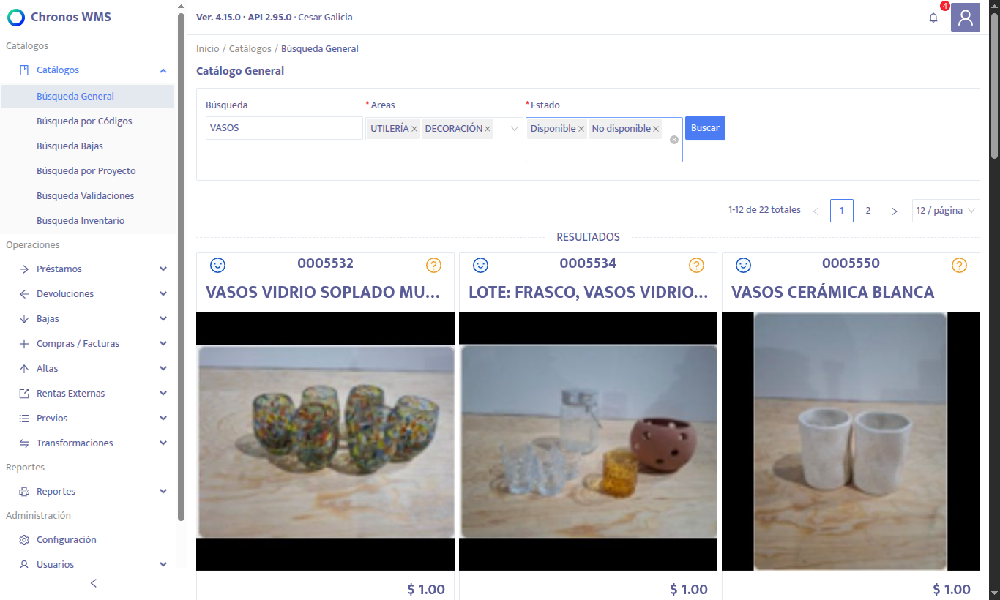

Al hacer clic en un resultado se abre una **ventana** con el detalle: fotos, existencias y la historia de movimientos
del artículo (pestaña **Movimientos**). Ciérrala y sigues en tu búsqueda.

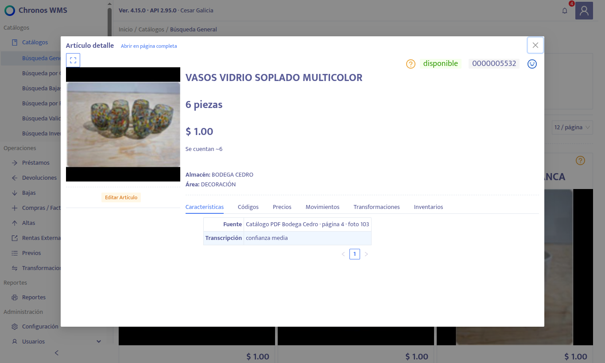

## H. Pedir un reporte

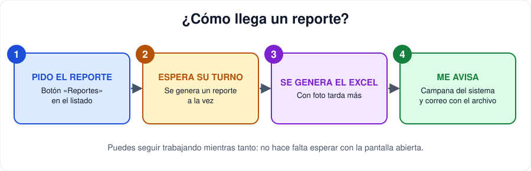

Dentro de cada listado, en **Préstamos Activos** y en las pantallas **Por Proyecto** hay un botón **Reportes**. Elige con foto o sin foto. El sistema
te avisa en la campana 🔔 y te manda el Excel por correo. Con foto tarda más.

---

## Errores frecuentes

| Problema | Qué hacer |
|---|---|
| Escaneé el artículo equivocado. | Bote de basura 🗑 (Quitar producto) en ese renglón. |
| Puse el artículo en el listado equivocado. | Pide al administrador que lo **mueva** a otro listado. |
| El nombre del listado está mal. | El administrador puede **cambiarle el nombre**. |
| No me deja devolver. | Revisa que el listado sea del **mismo proyecto** que tiene el artículo. |
| No encuentro mi listado. | Entra a **Por Listado** del mismo menú y haz clic en su nombre. |

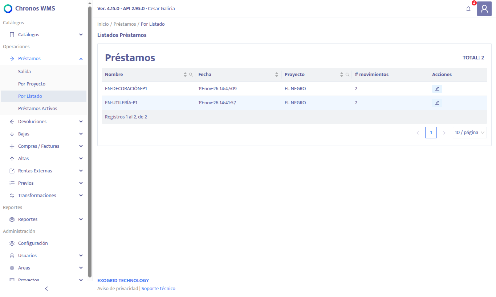
