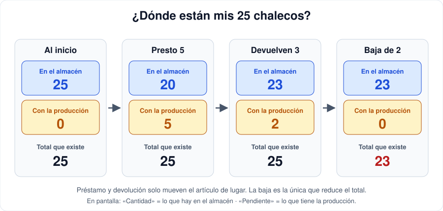
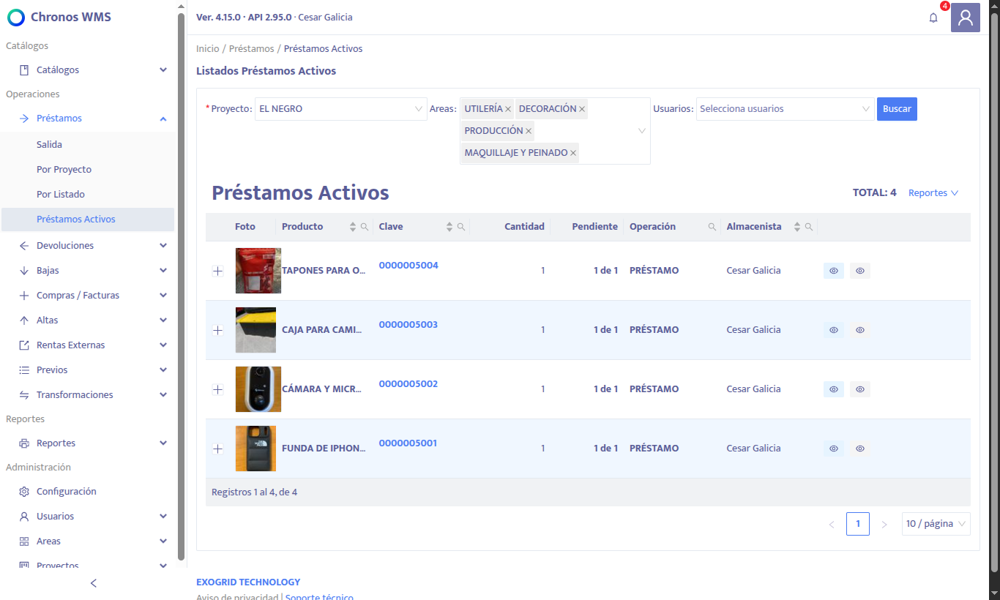
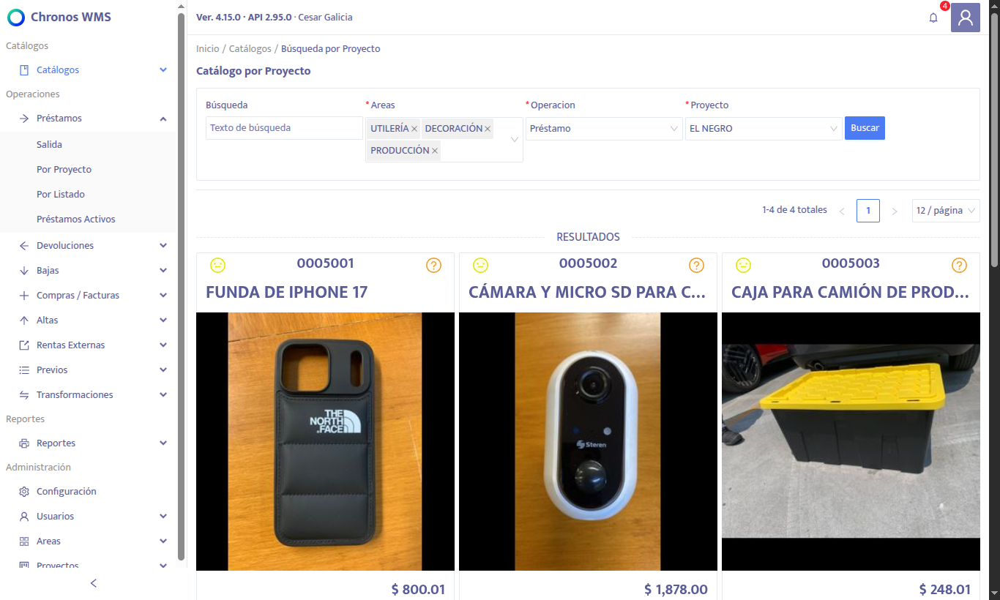
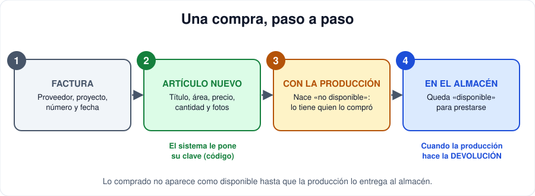
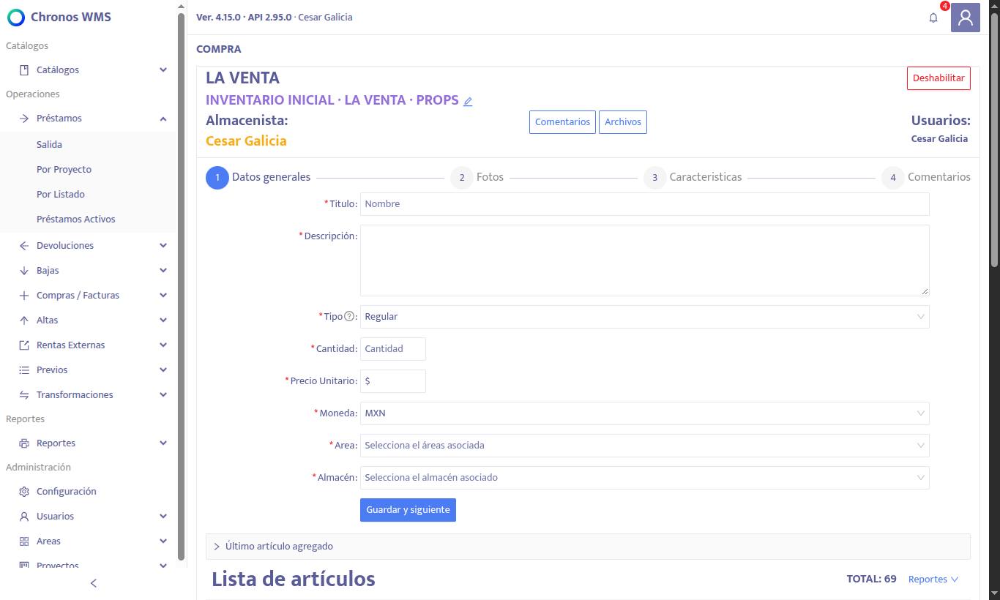
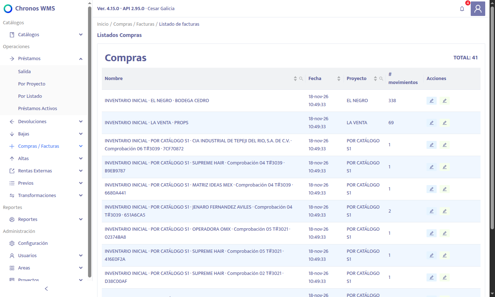
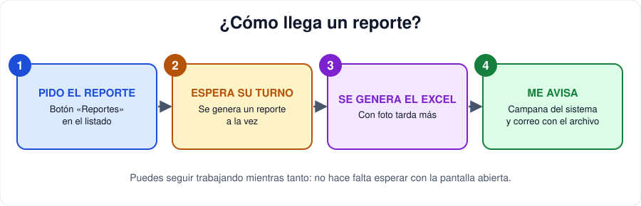

# 3 · Guía del encargado de producción

Para quien representa a una producción: consulta lo que tiene su proyecto y registra sus compras.
Antes lee [El flujo de datos](01-flujo-de-datos.md).

## Qué puedes hacer

| Puedes ✅ | No puedes ❌ |
|---|---|
| Buscar artículos por proyecto | Registrar préstamos, devoluciones o bajas (lo hace el almacén) |
| Registrar las compras (facturas) de tu producción | Cambiar usuarios o catálogos |
| Ver préstamos activos | |
| Consultar préstamos, devoluciones y bajas **por proyecto** | |
| Pedir reportes en Excel | |

> Si tu usuario tiene visibilidad **«Producción exclusiva»**, solo verás los artículos de **tus** proyectos.

## Lo que la producción debe saber

- Todo lo que el almacén te presta queda **pendiente** a nombre de tu proyecto hasta que lo regresas.
- Todo lo que **compras** también queda a tu nombre hasta que lo entregas al almacén.
- Lo que no regresa termina como **baja**: justificada (se gastó) o injustificada (se perdió).

## A. ¿Qué tiene mi producción ahora?

**Menú:** Operaciones → Préstamos → **Préstamos Activos**

Elige tu proyecto y pulsa **Buscar**. Muestra cada artículo que está fuera del almacén, con cuántas unidades faltan
por regresar (columna **Pendiente**).

## B. Consultar por proyecto

| Quiero ver… | Menú |
|---|---|
| Lo que me prestaron | Préstamos → **Por Proyecto** |
| Lo que ya regresé | Devoluciones → **Por Proyecto** |
| Lo que se dio de baja | Bajas → con Proyecto → **Por Proyecto** |
| Lo que compré | Compras / Facturas → **Compras Por Proyecto** |

En cada pantalla: elige el proyecto, pulsa buscar y abre el listado que te interesa.

## C. Buscar un artículo

**Menú:** Catálogos → **Búsqueda por Proyecto**

1. Elige las **Areas**.
2. Elige la **Operación**: Préstamo, Devolución, Baja Justificada, Baja Injustificada, Renta Externa o Compra.
3. Elige el **Proyecto**.
4. Pulsa **Buscar**. Haz clic en un resultado para ver su detalle en una ventana.

## D. Registrar una compra

**Menú:** Operaciones → Compras / Facturas → **Nueva Factura**

1. Llena el encabezado: proyecto, proveedor, tipo de factura, fecha, número de factura y responsables.
   Pulsa **Crear factura**.
2. Por cada artículo: título, descripción, tipo (**Regular** o **Expendable**), cantidad, precio unitario, moneda,
   área y almacén. Pulsa **Guardar y siguiente** y sube la foto.

   

3. El sistema le da una clave a cada artículo.

Para ver tus facturas: Compras / Facturas → **Listado de facturas**.

> 💡 ¿Regular o expendable? Si se gasta al usarlo (cinta, pilas, pintura, desechables), es **expendable**.

## E. Pedir un reporte

En las pantallas **Por Proyecto**, botón **Reportes**. Te llega a tu correo en Excel.
