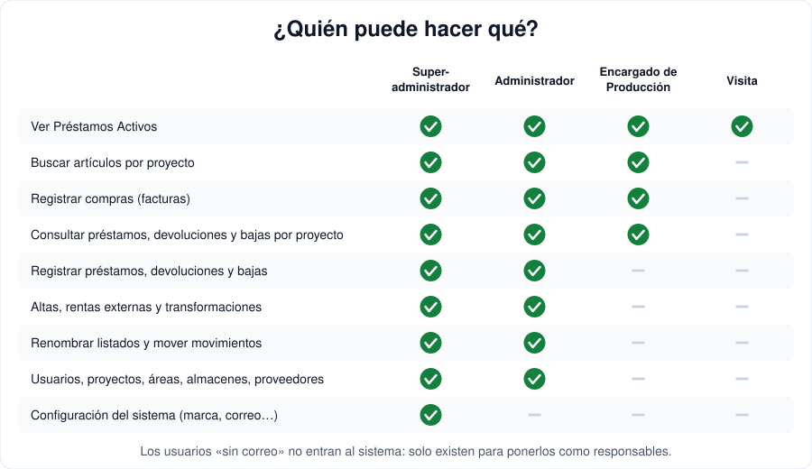
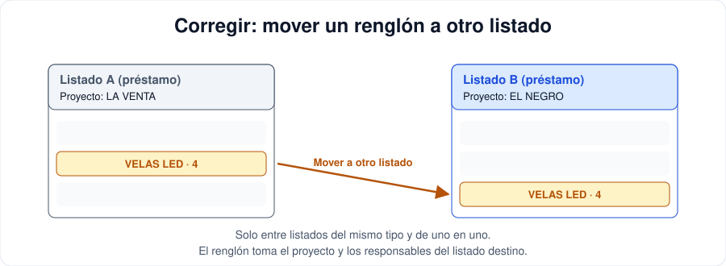
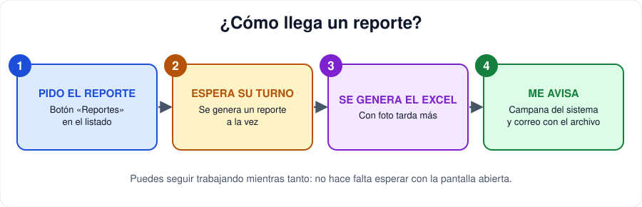

# 4 · Guía del administrador

Para quien administra usuarios y catálogos, corrige listados y pide reportes. Un administrador también puede hacer
todo lo de la [guía del operador](02-operador-almacen.md). Antes lee [El flujo de datos](01-flujo-de-datos.md).

## A. Usuarios y perfiles

**Menú:** Administración → Usuarios → **Nuevo** / **Listado**

Al crear un usuario eliges tres cosas:

**1. Perfil** — qué menús ve.

| Perfil | Para quién |
|---|---|
| **Superadministrador** | Puede todo, incluida la Configuración. |
| **Administrador** | Puede todo, menos la Configuración. |
| **Encargado de Producción** | Consulta su producción y registra compras. |
| **Visita** | Solo ve Préstamos Activos. |

**2. Sin correo** — marca esta casilla para personas que **no van a entrar al sistema** pero deben aparecer como
**responsables** en préstamos y devoluciones. El sistema les inventa un correo interno, nunca les manda correos ni
reportes, y no pueden iniciar sesión.

**3. Visibilidad** — qué artículos ve.

| Visibilidad | Qué ve |
|---|---|
| **General** | Todos los artículos. |
| **Producción exclusiva** | Solo los artículos de los proyectos que tiene asignados. |
| **Usuario exclusivo** | Solo los artículos donde él es responsable o los registró. |

Además se le asignan sus **Proyectos Internos**, **Areas** y **Almacenes**. Para «Producción exclusiva» los proyectos
asignados son los que podrá ver: sin proyectos no ve nada.

Reglas:

- Solo un Superadministrador puede crear o cambiar a otro Superadministrador.
- Nadie puede cambiar su propio perfil.
- Para restablecer contraseñas: Usuarios → **Cambiar Passwords**.

## B. Catálogos

| Catálogo | Menú | Para qué sirve |
|---|---|---|
| **Proyectos** | Administración → Proyectos | Las producciones. Sin proyecto no hay préstamos ni compras. |
| **Areas** | Administración → Areas | Los departamentos (Utilería, Decoración…). |
| **Almacenes** | Administración → Almacenes | Los lugares físicos. |
| **Proveedores** | Administración → Proveedores | A quién se le compra. Se elige en cada factura. |

> 💡 Da de alta primero proyectos, áreas y proveedores; después los usuarios; al final las operaciones.

## C. Corregir un listado

### Cambiar el nombre de un listado

1. Abre el listado.
2. Junto al nombre, pulsa el lápiz **Cambiar el nombre del listado**.
3. Escribe el nombre nuevo y guarda. El nombre no se puede repetir.

### Mover un renglón a otro listado

1. Abre el listado donde está el renglón equivocado.
2. En ese renglón, pulsa **Mover a otro listado**.
3. En la ventana, elige el listado destino y confirma.

Reglas:

- El listado destino **ya debe existir**. Si no existe, créalo primero.
- Solo entre listados **del mismo tipo**: préstamo con préstamo, compra con compra.
- Se mueve **de uno en uno**.
- El renglón toma el **proyecto y los responsables** del listado destino.
- Si el artículo ya tiene devoluciones o bajas ligadas, el sistema no deja cambiarlo de proyecto.
- Las transformaciones no se mueven.

## D. Productos por proveedor

**Menú:** Administración → Proveedores → **Productos por proveedor**

1. Elige el **proveedor**.
2. Si quieres, elige un **proyecto**. Sin proyecto muestra todos.
3. Aparece la lista de productos comprados a ese proveedor.
4. Botón **Reportes** → Excel sin foto o con foto.

## E. Reportes

| Reporte | Menú |
|---|---|
| Por listado | Dentro de cada listado o en **Por Listado** → Reportes |
| Por proyecto | Pantallas **Por Proyecto** → Reportes |
| Por proveedor | Proveedores → Productos por proveedor |
| Por usuario | Reportes → **Por Usuario** |
| Cierre de proyecto | Reportes → **Cierre de Proyecto** |

Qué decirle a los usuarios:

- Los reportes se generan **uno a la vez**. Si hay otros antes, el sistema avisa «Reporte en cola».
- Con foto tardan más y pesan más. Si solo se necesitan los datos, pedirlos **sin foto**.
- Si un reporte es demasiado grande, el sistema lo cancela y avisa. Hay que acotarlo: menos artículos o sin fotos.
- El archivo llega por correo y se avisa en la campana 🔔.

## F. Cierre de un proyecto

Antes de cerrar una producción revisa, en este orden:

1. **Préstamos Activos** del proyecto: no debe quedar nada pendiente.
2. Lo pendiente se resuelve con **devolución** (regresó) o **baja** (no regresó).
3. Pide el reporte **Cierre de Proyecto**.

## G. Configuración (solo Superadministrador)

**Menú:** Administración → **Configuración**. Nombre y logotipo del sistema, textos de la pantalla de entrada, correo
y moneda. Se cambia pocas veces.
