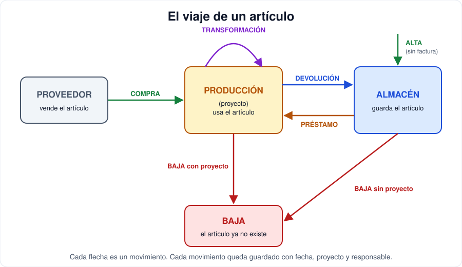
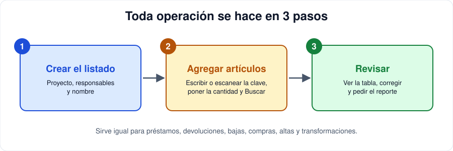

# Hoja de repaso

Una página para imprimir y tener junto a la computadora.

## Los 3 pasos de siempre

## ¿Qué quiero hacer? → ¿A qué menú voy?

| Quiero… | Menú |
|---|---|
| Entregar algo a una producción | Préstamos → **Salida** |
| Recibir algo de una producción | Devoluciones → **Devolución** |
| Ver qué está fuera del almacén | Préstamos → **Préstamos Activos** |
| Registrar algo perdido o gastado por una producción | Bajas → con Proyecto → **Baja** |
| Dar de baja algo que estaba en el almacén | Bajas → Sin Proyecto → **Baja Sin Proyecto** |
| Registrar una factura | Compras / Facturas → **Nueva Factura** |
| Meter algo al almacén sin factura | Altas → **Alta** |
| Registrar que un artículo se convirtió en otro | Transformaciones → **Nueva Transformación** |
| Encontrar un artículo | Catálogos → **Búsqueda General** |
| Ver qué tiene un proyecto | Catálogos → **Búsqueda por Proyecto** |
| Continuar un listado que dejé a medias | **Por Listado** del mismo menú |

## Tres números por artículo

| En el almacén 🟦 | Con la producción 🟧 | Total |
|:-:|:-:|:-:|
| Se puede prestar | Falta por regresar (pendiente) | Solo baja con una **baja** |

## Recuerda

- ✅ Revisa la **cantidad** antes de pulsar Buscar: siempre empieza en 1.
- ✅ La devolución va en un listado **del mismo proyecto** que tiene el artículo.
- ✅ Lo comprado se recibe en el almacén con una **devolución**.
- ✅ ¿Te equivocaste? **Quitar producto** en el renglón.
- ⚠️ La transformación **no** se puede deshacer.
- 🔔 Los reportes llegan por correo; con foto tardan más.
