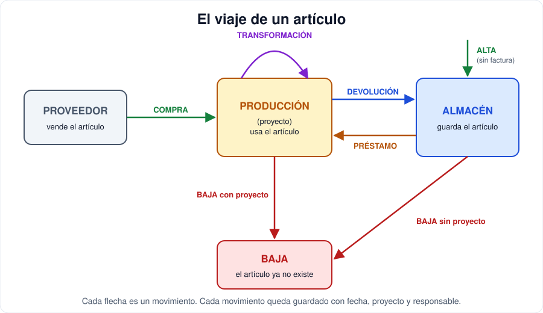

# Capacitación de Chronos WMS

Material para enseñar a usar el sistema de almacén. Está escrito para personas que **no** son técnicas: frases cortas,
un dibujo por idea y los nombres tal como aparecen en pantalla.

## Cómo usar esta carpeta

| Orden | Documento | Para quién | Tiempo |
|:-:|---|---|:-:|
| 1 | [El flujo de datos](01-flujo-de-datos.md) | **Todos**. Es la base: qué es un artículo, un listado y un movimiento. | 20 min |
| 2 | [Guía del operador de almacén](02-operador-almacen.md) | Quien presta, recibe, da de baja y registra compras. | 45 min |
| 3 | [Guía del encargado de producción](03-encargado-produccion.md) | Quien consulta lo que tiene su producción y registra sus compras. | 20 min |
| 4 | [Guía del administrador](04-administrador.md) | Quien da de alta usuarios y catálogos, corrige listados y pide reportes. | 30 min |
| — | [Hoja de repaso](05-hoja-de-repaso.md) | Todos. Una página para imprimir. | — |
| — | [Ejercicios para el instructor](instructor/ejercicios.md) | **Solo el instructor.** Ejemplos con los datos reales de staging. | — |

## Las cinco ideas que hay que llevarse

1. Un **artículo** tiene una **clave** (código de barras) y siempre está en uno de dos lugares: en el **almacén** o
   **con una producción**.
2. Todo lo que le pasa a un artículo es un **movimiento**: compra, préstamo, devolución, baja…
3. Los movimientos se anotan en **listados**, que son como hojas: un encabezado y un renglón por artículo.
4. Toda operación se hace en **3 pasos**: crear el listado, agregar artículos, revisar.
5. Nada se borra: cada movimiento queda guardado con fecha, proyecto y responsable.

## Ambiente de práctica

La capacitación se da en el ambiente de **staging**, que es una copia para practicar: lo que se haga ahí **no** afecta
al sistema real y **no** envía correos a nadie (los correos se quedan en un buzón de pruebas que ve el instructor).

## Mantenimiento

- Los diagramas de `img/` son SVG. Si cambia un nombre de menú o una regla, se corrige el texto del diagrama y la guía
  que lo usa.
- Las capturas de pantalla van en `img/capturas/`.
- Los nombres de menús y botones de estas guías corresponden al front `v4.15.0` y al API `v2.95.0`.
